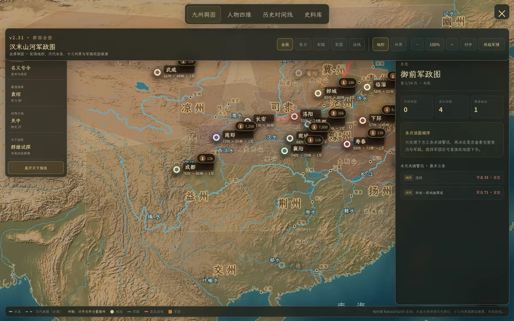

# 天子蒙尘：献帝模拟器

[](https://github.com/lv5accelerator-xy/xian-emperor-simulator/actions/workflows/release-check.yml)

扮演汉献帝刘协，在汉末危局中以奏报、诏令、外交与军略维系汉室的纯前端策略游戏。浏览器本地运行，无需安装、无需联网服务。

**[▶ 在线试玩](https://lv5accelerator-xy.github.io/xian-emperor-simulator/)**

| 开局 | 御前朝政 | 山河舆图 |
| --- | --- | --- |
|  |  |  |

## 玩法

- **五个历史剧本**：从中平六年的洛阳到延康元年的禅代前夜，每局 12 至 24 个月；每月裁决一件奏报，再用有限行动处理朝政。
- **自由拟旨**：用自己的话写诏书，用玺前复核涉及的人物、动作、城池顺序与军路；解析在本地完成。
- **朝堂与人物**：经营人物与派系关系，选择御前方略和三月施政目标。
- **军团与舆图**：在实测地形的山河舆图上调遣军团行军、野战、围城；舆图可切换东汉十三州界，水系与海岸按汉代修订。
- **诸侯外交**：军议、结盟协战、议和与遣使修好；外交结局以真实军务与长期履约为凭。
- **复玩目标**：五月短局、同题挑战、每周挑战与“汉祚长卷”连续大作战；终局可导出帝纪与千秋定论。

## 当前版本

<!-- CURRENT_VERSION_START -->
**v2.34.0**
舆图可只用键盘调兵：打开军团、下令、复核与成功后焦点移到军情栏标题，下令时可从下拉列表选目标城池，Esc取消军令；城池与军团标记有明显焦点环，军情变化由读屏播报。
城池圆点改落在实际坐标上，名牌按遮挡最少自动放在四个方位之一，军团标记、州名、河名山名与小地名依次避让，中原城池不再互相压住。桌面端下令成功后回执不再一闪即逝。
舆图数据（约170KB）改为第一次打开舆图或开局后空闲时才载入；军议、联军摘要卡的读屏名称只读标题。规则、数值、存档与全部存储格式不变。
<!-- CURRENT_VERSION_END -->

## 本地运行

无需安装依赖、无需构建，双击根目录的 `index.html` 即可游玩。

也可用任意静态服务器，例如 `python -m http.server 8000` 后访问 <http://localhost:8000/>。游戏不调用任何 AI 或付费接口；数据只保存在当前浏览器，不会上传。

## 存档

- 进度自动保存在浏览器 localStorage；“存档备份”保留最近三个月的完整备份，以及开新局、导入或恢复前的一份。
- 换设备、换浏览器或清理网站数据前，请用“导出”保存完整 JSON 存档；“导入”同时支持完整存档与旧版单一核心档。
- 字体、字号与舆图引导等偏好不随存档导出。
- 存储空间不足或被浏览器禁用时，页面会提示先导出存档。

## 仓库结构

| 路径 | 内容 |
| --- | --- |
| `index.html`、`styles.css` | 入口页与基础样式；脚本按固定顺序以经典 `<script>` 加载 |
| `src/` | 游戏数据、各系统模块、模块样式与内嵌人物立绘 |
| `assets/` | 本地字体子集、场景插图、背景音乐及第三方许可附件 |
| `tests/` | Node 回归测试，`*-regression.js` 由统一检查自动发现 |
| `scripts/` | 统一检查、浏览器回归、长局对照、版本与字体维护工具 |
| `docs/` | 规则、设计与维护文档，[文档索引](docs/README.md)；`docs/archive/` 为历史版本记录 |
| `CHANGELOG.md`、`patch-notes/` | 完整更新记录与逐版说明 |
| `history/` | v1.6.0–v2.13.0 历史发布 ZIP（约 613 MB），迁移方案见[历史包迁移](docs/RELEASE_MIGRATION.md) |
| `.github/` | CI 工作流与 Issue 模板 |

## 开发与测试

维护工具需要 Node.js 24，不是游玩前提。

```bash
node scripts/check.cjs                     # 全部语法检查与回归测试
node scripts/check-doc-links.cjs           # 文档内链接
node scripts/playthrough-equivalence.cjs origin/main   # 长局对照：重构不应改变玩法结果
```

- 统一检查自动发现 `src/**/*.js` 与 `tests/*-regression.js`，日志写入仓库相邻的 `validation/`，可用 `VALIDATION_OUTPUT` 改到别处。
- 长局对照用同一套对局脚本分别驱动基线与当前代码，比较 15 条固定种子完整对局终局时的全部存储，约两分钟。
- 浏览器回归在 `scripts/browser-*.cjs`，需要 Playwright；用自带 Chromium 时设 `BROWSER_CHANNEL=chromium COUNCIL_BROWSER_CHANNEL=chromium`，也可用 `PLAYWRIGHT_MODULE` 指向现有安装。

每个 PR 会运行三类检查：

| 任务 | 内容 |
| --- | --- |
| `validate` | 语法、资源引用与版本一致性，以及全部 Node 回归 |
| `browser` | 11 个真实浏览器回归，覆盖手机与桌面宽度，含文字对比度与舆图键盘操作 |
| `equivalence` | 长局对照；确实要改规则、数值或随机序列的 PR 加 `changes-gameplay` 标签跳过 |

贡献约定见[参与维护](CONTRIBUTING.md)，工程约定见[工程笔记](docs/ENGINEERING_NOTES.md)。

## 发布

GitHub Pages 直接从 `main` 根目录发布，没有构建步骤。

发布号以 `src/data.js` 为准。用 `node scripts/bump-version.cjs <新版本> --notes-file <说明> --dry-run` 预览，确认后去掉 `--dry-run`，它会同步页面标题、缓存参数、本文“当前版本”、更新记录与 patch-notes。流程见[部署说明](docs/DEPLOY_GITHUB_PAGES.md)。

## 文档

- [文档索引](docs/README.md)：当前规则、系统说明、维护记录与历史归档
- [游戏设计](docs/GAME_DESIGN.md) · [当前规则 v2.30](docs/RULES_V230.md) · [AI 接入边界](docs/AI_INTEGRATION.md)
- [更新记录](CHANGELOG.md) · [逐版说明](patch-notes/README.md)

## 授权

- 项目代码按 [MIT 许可证](LICENSE) 发布。字体、Natural Earth 数据与授权待确认的音乐、插图、立绘不在其内，见下文与 [CREDITS.md](CREDITS.md)。
- 逐项素材来源与待确认事项见 [CREDITS.md](CREDITS.md)；音乐、立绘等仍有授权缺项，不能由公开可见或“原创”字样推定再分发许可。
- 本地字体按 SIL OFL 1.1 分发，见[字体说明](assets/fonts/README.md)。
- 舆图地形、水系与海岸来自 Natural Earth 公有领域数据并按汉代修订，十三州界据郡治推算为近似，见[地图数据](docs/MAP_DATA.md)。
