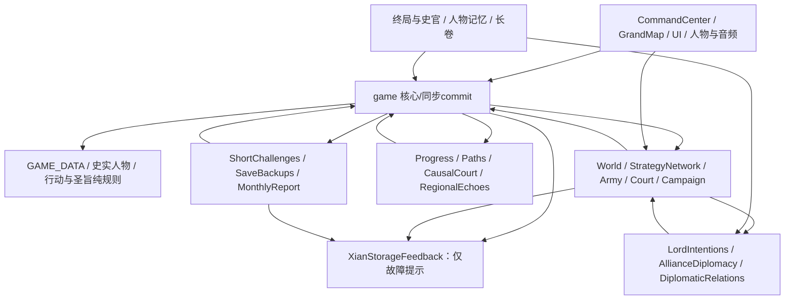

# 模块重构评估与回退计划

评估基线：v2.30.0，完成存储维护后。本文只给方案，没有改加载方式、导出方式、文件名或运行前提。当前仍为传统script，直接双击index.html运行。

## 现有加载次序

共68个同步经典脚本；前三个在head恢复故障提示、字体与字号，余者位于body末。不得按文件名字母排序；部分依赖在IIFE求值时读取，部分直到DOMContentLoaded或同步commit才读取。

| 顺序 | 脚本及当前缓存参数 |
| --- | --- |
| 1 | src/storage-feedback.js?v=2.30.0 |
| 2 | src/typography.js?v=2.30.0 |
| 3 | src/reading-settings.js?v=2.30.0 |
| 4 | src/edict-rules.js?v=2.30.0 |
| 5 | src/data.js?v=2.30.0 |
| 6 | src/character-availability.js?v=2.30.0 |
| 7 | src/world-data.js?v=1.5.1 |
| 8 | src/strategy-network-data.js?v=2.30.0 |
| 9 | src/army-data.js?v=1.5.1 |
| 10 | src/campaign-evolution-data.js?v=1.5.1 |
| 11 | src/historical-geography-data.js?v=2.6.1 |
| 12 | src/grand-map.js?v=2.30.0 |
| 13 | src/portraits/liu_xie.js?v=1.5.1 |
| 14 | src/portraits/empress_fu.js?v=1.5.1 |
| 15 | src/portraits/dong_cheng.js?v=1.5.1 |
| 16 | src/portraits/yang_biao.js?v=1.5.1 |
| 17 | src/portraits/xun_yu.js?v=1.5.1 |
| 18 | src/portraits/cao_cao.js?v=1.5.1 |
| 19 | src/portraits/yuan_shao.js?v=1.5.1 |
| 20 | src/portraits/yuan_shu.js?v=1.5.1 |
| 21 | src/portraits/liu_biao.js?v=1.5.1 |
| 22 | src/portraits/sun_ce.js?v=1.5.1 |
| 23 | src/action-plans.js?v=2.30.0 |
| 24 | src/monthly-safety.js?v=2.30.0 |
| 25 | src/action-feedback.js?v=2.15.0 |
| 26 | src/scenario-220-story.js?v=2.30.0 |
| 27 | src/diplomatic-endings.js?v=2.30.0 |
| 28 | src/game.js?v=2.30.0 |
| 29 | src/monthly-report.js?v=2.30.0 |
| 30 | src/world-system.js?v=2.30.0 |
| 31 | src/decree-world.js?v=2.30.0 |
| 32 | src/lord-intentions.js?v=2.30.0 |
| 33 | src/diplomatic-relations.js?v=2.30.0 |
| 34 | src/alliance-diplomacy.js?v=2.30.0 |
| 35 | src/strategy-network.js?v=2.30.0 |
| 36 | src/decree-confirmation.js?v=2.30.0 |
| 37 | src/decree-helper.js?v=2.30.0 |
| 38 | src/army-system.js?v=2.30.0 |
| 39 | src/court-politics.js?v=2.30.0 |
| 40 | src/portraits.js?v=1.5.1 |
| 41 | src/imperial-progress-data.js?v=1.5.1 |
| 42 | src/imperial-progress.js?v=2.30.0 |
| 43 | src/campaign-evolution.js?v=2.30.0 |
| 44 | src/command-center.js?v=2.30.0 |
| 45 | src/character-memory.js?v=2.30.0 |
| 46 | src/world-marks.js?v=2.30.0 |
| 47 | src/historian.js?v=2.30.0 |
| 48 | src/dynasty-saga.js?v=2.30.0 |
| 49 | src/monthly-flow.js?v=2.30.0 |
| 50 | src/consequence-echoes.js?v=2.30.0 |
| 51 | src/short-score.js?v=2.30.0 |
| 52 | src/short-review.js?v=2.30.0 |
| 53 | src/same-challenge.js?v=2.30.0 |
| 54 | src/short-challenges.js?v=2.30.0 |
| 55 | src/weekly-challenge.js?v=2.30.0 |
| 56 | src/final-verdict.js?v=2.30.0 |
| 57 | src/causal-court.js?v=2.30.0 |
| 58 | src/quarterly-agenda.js?v=2.30.0 |
| 59 | src/council-advice.js?v=2.30.0 |
| 60 | src/regional-echoes.js?v=2.30.0 |
| 61 | src/imperial-paths.js?v=2.30.0 |
| 62 | src/audio-data.js?v=1.5.1 |
| 63 | src/audio-tracks.js?v=1.5.1 |
| 64 | src/audio.js?v=2.30.0 |
| 65 | src/ui.js?v=2.6.1 |
| 66 | src/ui-refresh-v280.js?v=2.30.0 |
| 67 | src/gameplay-polish.js?v=2.14.0 |
| 68 | src/save-backups.js?v=2.30.0 |

## 全局依赖图

图为按功能聚合的依赖概览；箭头表示调用方依赖被调用方，不代表可直接转成无环的静态import。精确逐文件window符号表见[只读盘点](AUDIT_2026-11.md)；本阶段新增XianStorageFeedback，供28个原有写入模块失败时调用。

主要全局分为GAME_DATA及XIAN_*只读数据、Xian*公开API、__xian*导入/提交/监听协调标志。后者不是可以随手删除的调试字段。Storage.prototype.setItem监听器、DOM事件、模块闭包状态和延迟回调也构成依赖，纯文本window扫描不能证明它们全部互相独立。

## 双击运行与ES Modules的取舍

浏览器对file://的模块加载通常按不透明来源实施CORS限制；把所有script直接改成type=module会使本地双击失效。模块还默认延迟求值，this、作用域和DOMContentLoaded注册次序随之变化，即使GitHub Pages能加载也不代表玩法和存档一致。不能用要求玩家关闭浏览器安全策略、安装npm或先启动服务器来宣称保住双击运行。

建议本轮继续经典script和IIFE接口；先缩小全局依赖并书面固定初始化/提交协议。将ES Modules作为所有者另行决定的可选目标：

- **保留双击（默认）**：经典入口保持唯一实际玩法实现，不发布模块入口；可以按功能整理接口，但暂缓原生ESM迁移。
- **允许HTTP专用入口**：另行确认放弃该入口的file://支持后，提供module入口并以GitHub Pages/任意静态HTTP服务运行。仍无框架和构建步骤，但必须明确标注双击限制。
- **双入口过渡**：只有在纯数据/纯函数能由同一实现供两种入口使用时才考虑；不得人工维护两套规则或引入预编译产物作为运行前提。经典全局实现加模块外观可用于实验，却不能消除原有全局或证明完成迁移。

当前未批准牺牲双击运行，因此不执行ESM转换。

## 分步方案与独立回退点

| 步骤 | 改动范围与验收 | 风险 | 回退方式 |
| --- | --- | --- | --- |
| 0 契约冻结 | 记录加载顺序、window API、存储键与所有同步commit监听；保存固定种子全流程和完整包 | 扫描遗漏动态依赖 | 纯文档提交可独立撤销 |
| 1 经典接口整理 | 在独立分支为纯规则增加明确参数/返回值说明，保留同名API与原加载顺序；不同时改逻辑 | 隐式读全局、初始化时机 | 单独提交，恢复原函数/脚本即可；不改档 |
| 2 模块沙盒 | 在单独实验入口先迁移最小纯数据/纯函数，保留经典正式入口，HTTP与file://分别观察 | CORS、defer、重复初始化 | 删除实验入口并恢复引用；正式入口不受影响 |
| 3 显式装配 | 以工厂参数注入跨模块API，集中一次初始化；先拆game↔world/army和挑战/备份循环 | 执行次序和存储观察者反复安装；一次commit失收敛 | 按子系统一提交，恢复原全局适配接口；禁止夹带数据迁移 |
| 4 ESM入口切换 | 仅在所有者选择HTTP入口后，逐个type=module/import；测试无DOM预期漂移、无重复监听、全量固定种子与存档差异为零 | 顶层声明不再挂window、strict/defer行为、跨来源缓存 | 切回经典index入口；上一入口和资源至少保留一个发布周期 |
| 5 清理旧桥 | 证明没有旧页面/测试/存档路径依赖后，单独删除兼容全局与旧入口 | 离线旧页面引用、收藏链接与缓存 | 保留旧资源地址；单提交撤回；出现任何玩法差异即停止 |

每一步独立分支、单一目的中文提交；不得将规则调整、改存储结构、ESM切换和文件改名捆绑。每步运行node scripts/check.cjs、全部tests回归、文档链接检查，另做桌面/手机真实浏览器交互、file://直接打开、旧档/完整档恢复和固定种子逐月对照。只比较胜率不足以证明随机序列未变。

## 按功能命名建议（未改名）

| 当前文件 | 建议名称 | 说明 |
| --- | --- | --- |
| src/ui-refresh-v280.js | src/responsive-controls.js | 先核实移动导航/工具组织职责，保留原执行位置 |
| src/ui-refresh-v280.css | src/responsive-layout.css | 与上行配套；旧路径在过渡期保留 |
| src/visual-refresh.css | src/visual-theme.css | 视觉主题层，不以发布版本命名 |
| src/game.js | src/game-core.js | 核心状态、行动与同步提交；先拆纯接口再改名 |
| src/data.js | src/game-data.js | 产品版本仍有唯一来源；bump-version及测试同步改路径 |
| src/ui.js | src/interface-events.js | 避免与响应式控制层职责混淆 |
| src/gameplay-polish.js / .css | src/interaction-guidance.js / .css | 需先确认实际职责，不能把玩法规则迁到展示层 |
| src/causal-court.js / .css | src/court-causality.js / .css | 以功能命名；无需因版本变化反复改名 |
| src/monthly-report.js / .css | 保留现名 | 已按功能命名，无需为统一而改名 |
| src/scenario-220-story.js / .css | 保留现名 | 220指史实年份剧本，不是产品版本；不可误当v2.20 |
| src/portraits/*.js | 保留人物id | 存档和人物配置使用稳定id，不重命名这些id |

任何实际改名都必须同步index、测试、脚本、工作流、说明链接和缓存引用；不得改localStorage版本后缀来追随文件命名。当前所有映射仅是评估，没有执行。
